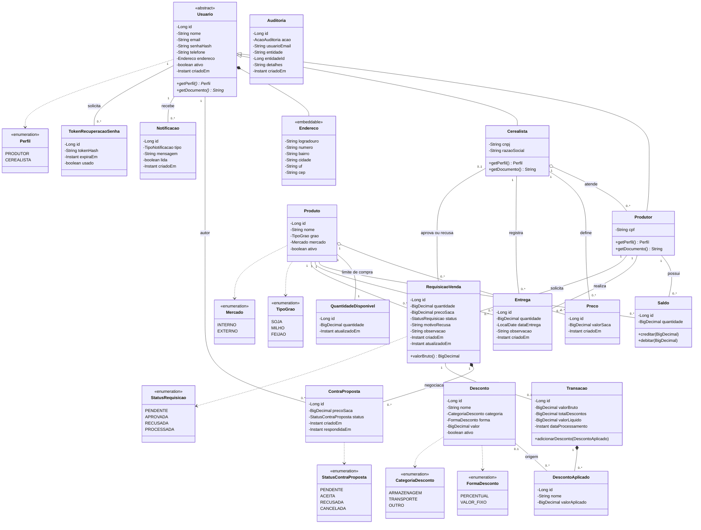
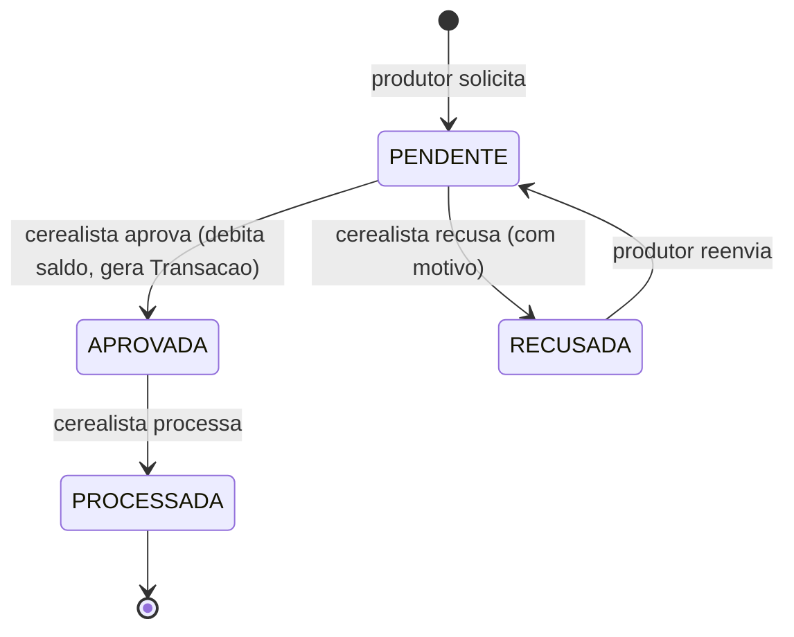
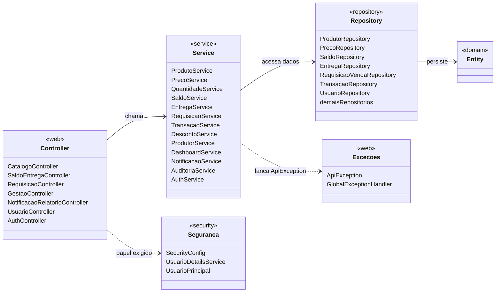

# Diagrama de classes — SafraLink

Classes de domínio do back-end (pacote `br.com.safralink.domain`), com atributos principais, métodos de negócio e
relacionamentos. O diagrama é Mermaid: o GitHub e o VS Code (extensão *Markdown Preview Mermaid Support*) o exibem
renderizado. O modelo relacional correspondente está em [`modelo-dados.md`](modelo-dados.md).

## 1. Domínio

`Auditoria` é independente de propósito: guarda um retrato do autor (nome e e-mail) sem chave estrangeira, para
sobreviver à exclusão de usuários.

### Ciclo de vida da requisição de venda

## 2. Camadas da aplicação

Regra de arquitetura: os controllers não acessam repositórios; todo acesso a dados e toda regra de negócio passam pela
camada de serviço.
