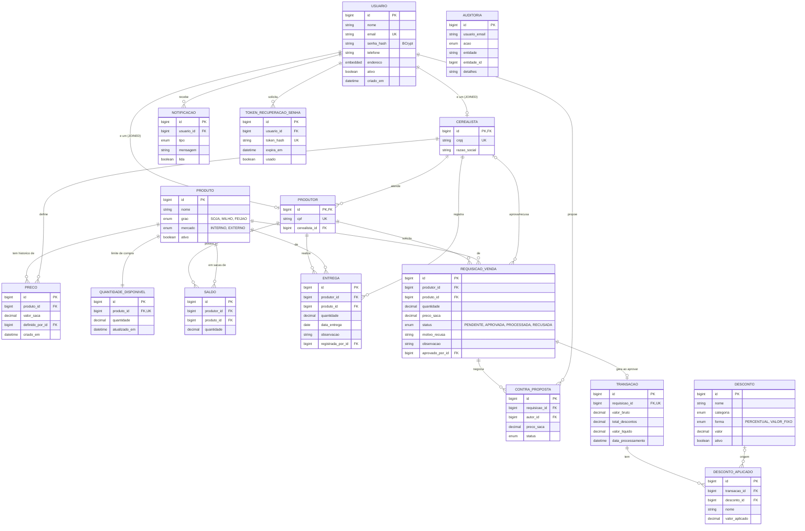

# Modelo de dados — SafraLink

Diagrama entidade-relacionamento do banco MySQL (16 entidades JPA). O diagrama é Mermaid: o GitHub e o VS Code
(extensão *Markdown Preview Mermaid Support*) o exibem renderizado.

## Leitura rápida

| Grupo | Entidades | Papel no domínio |
| --- | --- | --- |
| Pessoas | `Usuario` → `Produtor` / `Cerealista` | herança JPA `JOINED`; o papel (`ROLE_PRODUTOR` / `ROLE_CEREALISTA`) vem do tipo |
| Catálogo | `Produto`, `Preco`, `QuantidadeDisponivel` | grão + mercado; preço com histórico; limite de compra da cerealista |
| Estoque do produtor | `Saldo`, `Entrega` | a entrega registrada pela cerealista credita o saldo em sacas |
| Venda | `RequisicaoVenda`, `ContraProposta`, `Transacao`, `DescontoAplicado`, `Desconto` | fluxo solicitar → negociar → aprovar → processar, com descontos automáticos |
| Apoio | `Notificacao`, `Auditoria`, `TokenRecuperacaoSenha` | avisos, trilha de auditoria e recuperação de senha |

Integridade: chaves estrangeiras e `CHECK` (quantidades e preços positivos) no próprio schema
(`src/main/resources/db/migration`), com `ddl-auto: validate` para o Hibernate conferir o mapeamento na subida.
