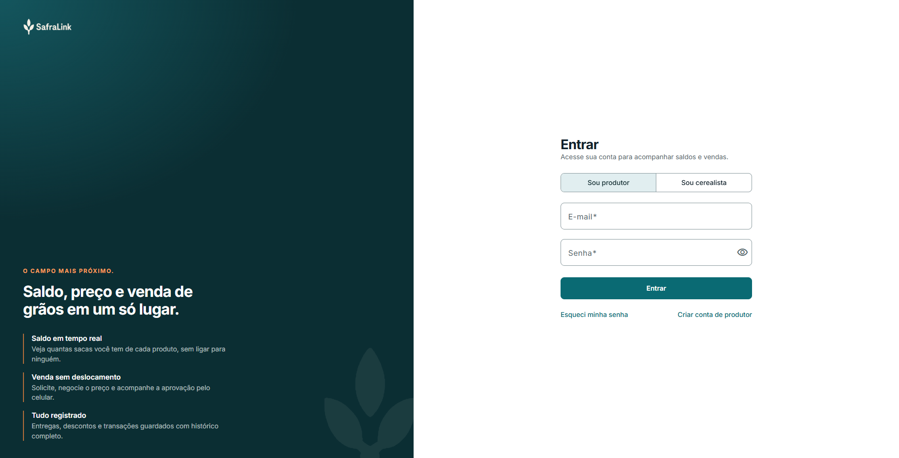
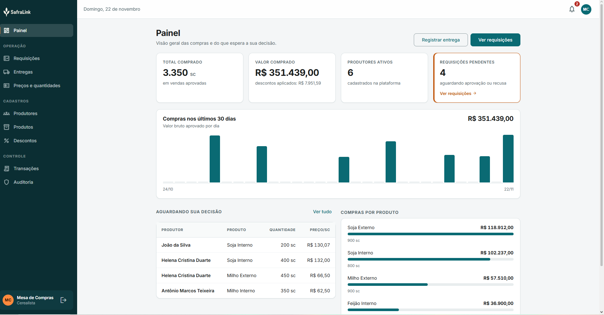
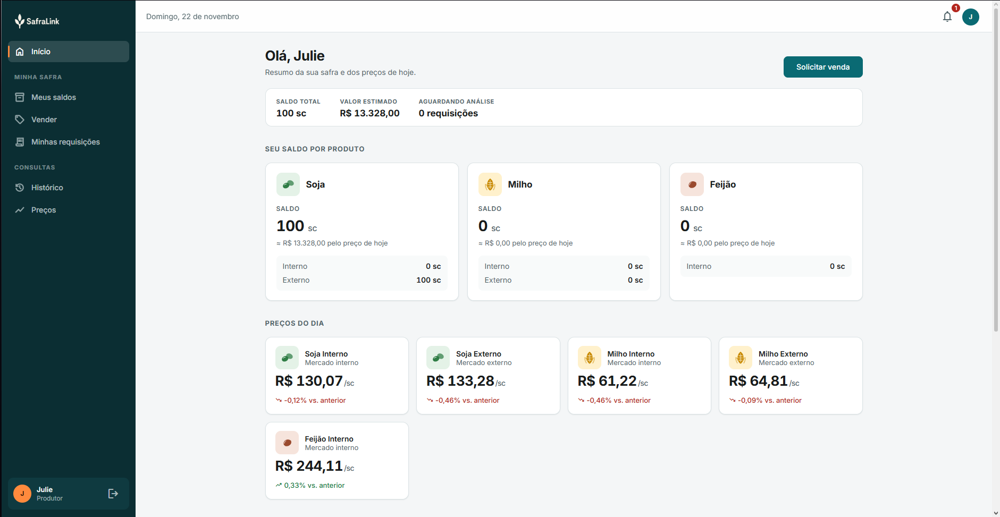

<p align="center">
  
</p>

<p align="center">
  <strong>Saldo, preço e venda de grãos em um só lugar.</strong><br>
  Plataforma web que conecta produtores rurais e cerealistas.
</p>

<p align="center">
  <a href="https://safralink-omega.vercel.app"><strong>Aplicação publicada</strong></a> ·
  <a href="AVALIACAO.md"><strong>Guia de avaliação</strong></a> ·
  <a href="Back-end/docs/documentacao-api.md"><strong>Documentação da API</strong></a>
</p>

---

## Sobre o projeto

Hoje o produtor rural entrega a safra à cerealista e, para saber quanto tem em estoque, qual o preço do dia ou se a venda foi aprovada, precisa ligar, anotar ou conferir planilhas. Do outro lado, a cerealista controla saldos, preços e descontos de vários produtores de forma manual.

O **SafraLink** centraliza esse processo. A cerealista registra as entregas e o produtor passa a ver o próprio saldo, o preço do dia e pode solicitar a venda de parte do que entregou, negociando o preço. A cerealista aprova ou recusa, os descontos são aplicados automaticamente e tudo fica registrado em histórico e auditoria.

Projeto Integrador IV — Engenharia de Software, UNIFIO. Equipe **404 Team**.

## Telas

<p align="center">
  
</p>

<p align="center">
  
</p>

<p align="center">
  
</p>

## Funcionalidades

**Produtor**
- Saldo por produto e por mercado (interno e externo), com valor estimado pelo preço do dia
- Preços do dia e histórico de variação
- Solicitação de venda limitada ao saldo disponível, com edição e cancelamento
- Negociação do preço por contra-proposta
- Histórico de vendas e contrato de venda (impressão ou PDF)
- Notificações e exportação de relatório em CSV

**Cerealista**
- Painel com total comprado, valor comprado, produtores ativos, requisições pendentes e gráfico dos últimos 30 dias
- Registro de entregas, que creditam o saldo do produtor
- Preços e quantidade disponível para compra
- Aprovação ou recusa de requisições, com aplicação automática de descontos
- Cadastro de produtores, produtos e descontos
- Transações, auditoria de ações e relatórios em CSV

## Tecnologias

| Camada | Tecnologias |
| --- | --- |
| Front-end | Angular 21 (NgModules), Angular Material, SCSS, RxJS, Vitest |
| Back-end | Java 21, Spring Boot 3.5, Spring Security (HTTP Basic), Spring Data JPA, Flyway, Bean Validation |
| Banco de dados | MySQL 8 |
| Publicação | Vercel (front-end), Render (API), Aiven (MySQL) |

## Documentação

| Documento | Conteúdo |
| --- | --- |
| [Diagrama de classes](Back-end/docs/diagrama-de-classes.md) | Modelo de domínio, estados da requisição e camadas |
| [Modelo de dados](Back-end/docs/modelo-dados.md) | Diagrama entidade-relacionamento |
| [Documentação da API](Back-end/docs/documentacao-api.md) | Endpoints, regras de negócio e códigos HTTP |
| [Coleção do Postman](Back-end/postman/projeto-integrador.postman_collection.json) | Requisições com exemplos de resposta |
| [README do back-end](Back-end/README.md) | Execução, configuração e decisões técnicas |
| [README do front-end](Front-end/Front/README.md) | Estrutura e execução do front-end |
| [Guia de avaliação](AVALIACAO.md) | Acesso de teste, roteiro e mapa dos requisitos |

## Executar localmente

Pré-requisitos: JDK 21, Node.js e Docker.

```bash
# Banco (MySQL) e API em http://localhost:8080
cd Back-end && docker compose up -d
cd safralink-api && ./mvnw spring-boot:run -Dspring-boot.run.profiles=dev

# Front-end em http://localhost:4200
cd Front-end/Front && npm install && npm start
```

As contas de demonstração do perfil `dev` estão em [`Back-end/README.md`](Back-end/README.md).
